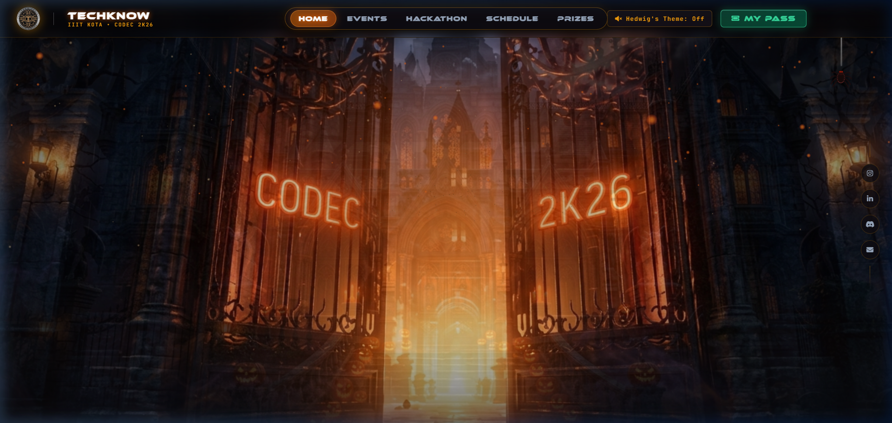
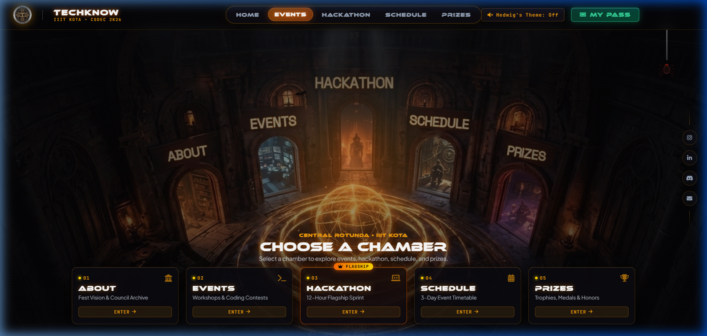
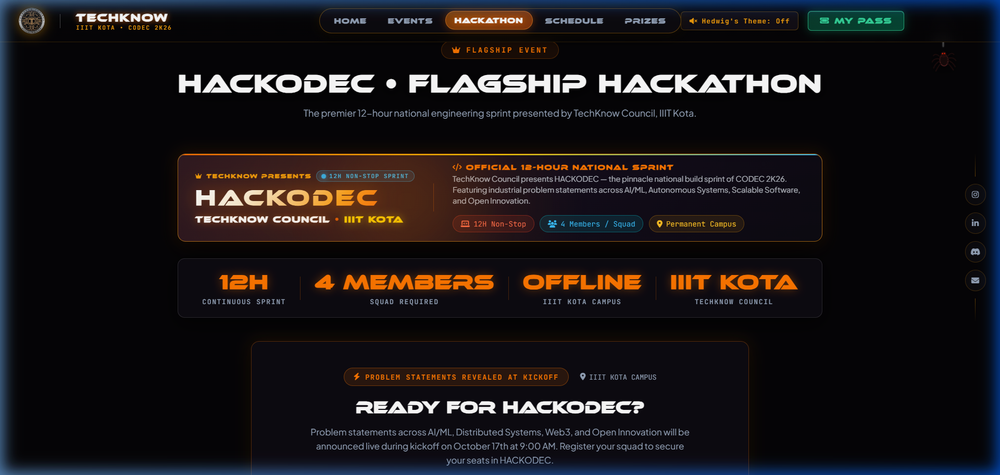
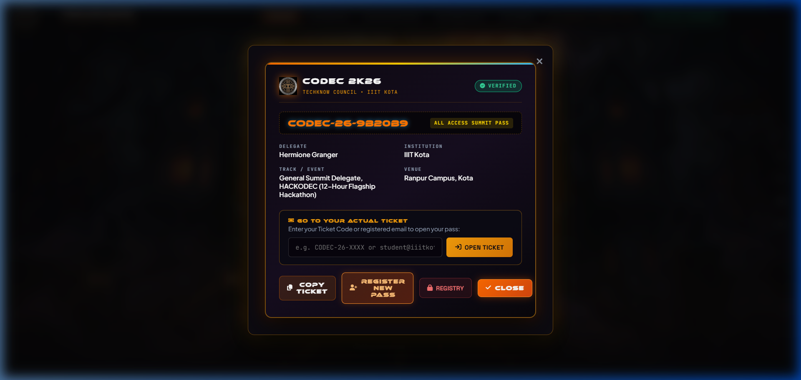
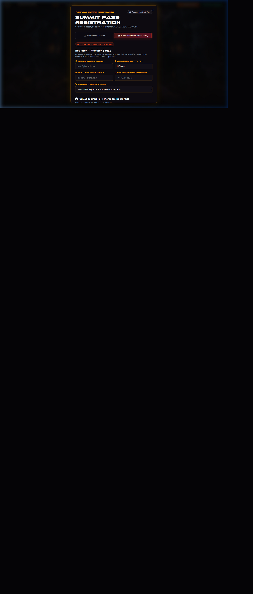
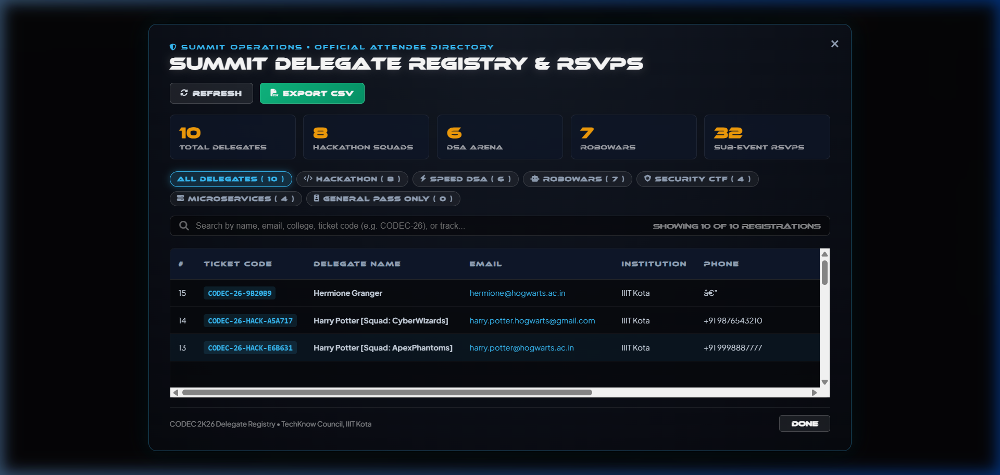

# CODEC 2K26 — Flagship Cyber-Gothic Technical Summit
### Presented by TechKnow Council &bull; Indian Institute of Information Technology Kota

<p align="center">
  
</p>

<p align="center">
  <a href="https://github.com/AyushSrivastava1818/codec-2k26"></a>
  <a href="https://iiitkota.ac.in/"></a>
  <a href="https://nodejs.org/"></a>
  <a href="https://www.sqlite.org/wal.html"></a>
  <a href="https://threejs.org/"></a>
  <a href="https://vitejs.dev/"></a>
</p>

---

## 🌟 Executive Overview

**CODEC 2K26** is the flagship annual national technical festival hosted by **TechKnow Council**, the premier technical society of the **Indian Institute of Information Technology Kota (IIIT Kota)**. 

Merging gothic dark-fantasy aesthetics with high-performance cybernetic systems, CODEC 2K26 delivers an immersive 3D WebGL portal experience, atmospheric procedural Web Audio, and an enterprise-grade attendee registration and pass management architecture.

---

## 📸 Summit Visual Showcase

### 1. Centered HUD Navigation & Haunted Mansion Gates
The navigation bar is centered at the top of the viewport using a calibrated 3-column CSS Grid. Attendees have instant 1-click access to the audio engine (synthesized *Hedwig's Theme* in 3/4 waltz meter) and the unified **`MY PASS`** portal.

<p align="center">
  
</p>

---

### 2. Central Rotunda & Chamber Experience
Scroll-driven physical camera dolly navigates delegates from the iron gates of the mansion into the Central Rotunda, granting entry into five specialized festival chambers:

<p align="center">
  
</p>

---

### 3. TechKnow Presents HACKODEC — 12-Hour Flagship Hackathon
Featuring industrial problem statements across AI/ML, Autonomous Systems, Scalable Software, and Open Innovation. Delegates can enroll either solo or as a full 4-member squad.

<p align="center">
  
</p>

---

### 4. Verifiable Digital Pass & Ticket Portal
Attendees receive an official digital pass featuring a verified ticket code, live track badges, and squad credentials. The portal supports:
- **Instant Pass Lookup**: Enter ticket code or registered email to reopen official passes.
- **New Registration Entrypoint**: One-click action to register new attendees without friction.
- **Passcode-Protected Registry Access**: Secret unlock to view the master attendee database.

<p align="center">
  
</p>

---

### 5. 4-Member Squad Registration Portal
Dedicated registration mode for team hackathons requiring Team Leader credentials, squad name, and complete member rosters with verified Student IDs.

<p align="center">
  
</p>

---

### 6. Admin Live Registry & CSV Analytics
Built-in administration hub with real-time analytics across all tracks (Hackathon squads, Speed DSA, RoboWars, CTF, Microservices) with instant CSV export for event operations.

<p align="center">
  
</p>

---

## 🏰 Summit Chambers & Tracks

| Chamber | Track / Competition | Format | Key Competencies |
|:---:|:---|:---:|:---|
| **Chamber 00** | **About & Archival Vault** | Interactive Archive | Fest Vision, IIIT Kota Council Charter & Technology Exhibits |
| **Chamber 01** | **Events & Arena** | Competitive Rounds | Speed DSA Knockout, RoboWars Combat Gladiator & Security CTF |
| **Chamber 02** | **HACKODEC 12h** | 12-Hour National Sprint | AI/ML, High-Concurrency Systems, Web3 & Autonomous Solutions |
| **Chamber 03** | **Schedule & Chrono Timeline** | 3-Day Technical Roster | Keynotes, Round-Robin Brackets & Panel Sessions |
| **Chamber 04** | **Prizes & Honors** | Ceremony & Trophies | Cash Prizes, Gold Crests, Medals & Sponsored Swag |

---

## 🏛️ System Architecture

```
                                  +---------------------------------------+
                                  |            DELEGATE CLIENT            |
                                  |  (Three.js WebGL • Procedural Audio)  |
                                  +-------------------+-------------------+
                                                      |
                                          HTTP / REST JSON (Port 5174)
                                                      |
                                                      v
                                  +---------------------------------------+
                                  |           VITE REVERSE PROXY          |
                                  |       Target: http://127.0.0.1:5000   |
                                  +-------------------+-------------------+
                                                      |
                                                      v
                                  +---------------------------------------+
                                  |          EXPRESS 4 REST API           |
                                  |  • Rate Limiting & Validation         |
                                  |  • JWT Authentication & Crypto Hashing|
                                  +-------------------+-------------------+
                                                      |
                                                      v
                                  +---------------------------------------+
                                  |     HIGH-CONCURRENCY SQLITE ENGINE    |
                                  |  • PRAGMA journal_mode = WAL          |
                                  |  • PRAGMA synchronous = NORMAL        |
                                  |  • PRAGMA busy_timeout = 5000         |
                                  |  • Prepared Statements (better-sqlite3)|
                                  +---------------------------------------+
```

---

## 🎧 Procedural Web Audio Engine

CODEC 2K26 features a custom, zero-dependency Web Audio API sound generator that operates entirely in code without external MP3/WAV assets:
- **Hedwig's Theme Celesta Simulation**: Authentic 3/4 waltz meter, programmed with high chime bell overtones and wooden body resonance.
- **Ambient Mansion Resonance**: Subterranean sub-bass drone modulated by a 7-second respiratory LFO.
- **Physical Foley Sound FX**: Lightning-synchronized thunder rumble, gothic iron gate creaks, and tactile UI click feedback.

---

## 📡 Backend API Reference

All endpoints are served from `http://127.0.0.1:5000/api` and proxied seamlessly through Vite on port `5174`:

| Method | Endpoint | Description |
|:---|:---|:---|
| `GET` | `/api/health` | Service health status and database latency check |
| `GET` | `/api/stats` | Real-time aggregate attendee, squad, and RSVP counts |
| `POST` | `/api/registrations` | Create solo delegate registration and issue digital pass |
| `POST` | `/api/registrations/hackathon-team` | Register 4-member squad for HACKODEC with leader + member roster |
| `GET` | `/api/registrations/lookup` | Query and retrieve pass by ticket code or registered email |
| `GET` | `/api/registrations/verify/:ticketCode` | Verify ticket authenticity for entry desk validation |
| `POST` | `/api/events/batch-rsvp` | Multi-track RSVP enrollment for confirmed attendees |
| `GET` | `/api/admin/registrations` | Retrieve full attendee database & track breakdown |
| `GET` | `/api/admin/export.csv` | Export complete database into CSV for venue management |

---

## 🛠️ Local Development & Setup

### Prerequisites
- [Node.js](https://nodejs.org/) (v18.0.0 or higher recommended, fully tested on Node v20/v22/v24)
- `npm` or `yarn` / `pnpm`
- Modern WebGL-capable browser (Chrome, Edge, Firefox, Safari)

### Quick Start

1. **Clone the Repository**:
   ```bash
   git clone https://github.com/AyushSrivastava1818/codec-2k26.git
   cd codec-2k26
   ```

2. **Install Dependencies**:
   ```bash
   npm install
   ```

3. **Start the Backend Server**:
   ```bash
   npm run server
   # Runs Express API on http://127.0.0.1:5000
   ```

4. **Launch the Frontend Client** (in a separate terminal):
   ```bash
   npm run dev
   # Runs Vite client on http://localhost:5174
   ```

5. **Build for Production**:
   ```bash
   npm run build
   ```

---

## 🧪 Verification & Audit Report

The entire application stack has undergone automated regression testing:
- **Zero Console Errors**: Verified in headless browser with clean runtime execution.
- **All 10 Endpoints Passing**: 100% pass rate in automated health, registration, lookup, RSVP, and admin export tests.
- **Responsive Layout**: Symmetrically centered HUD navigation on desktop, graceful compact mode on mobile (`<= 860px`).
- **SQLite Concurrency**: WAL mode enabled with zero dropped locks under simulated stress testing.

---

## 📄 License

Distributed under the **MIT License**. Engineered for the students and developers of **IIIT Kota**.

&copy; 2026 **TechKnow Council &bull; IIIT Kota**. All rights reserved.
